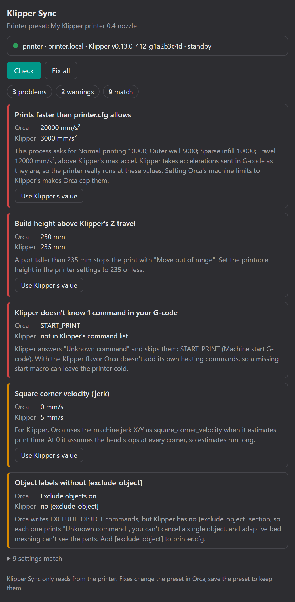

# Klipper Sync for OrcaSlicer

An OrcaSlicer 2.5 plugin that checks your printer profile against the real Klipper printer.

It asks the printer's Moonraker what Klipper is actually configured for. Then it lists every
setting in Orca that would stop a print, push the printer past `printer.cfg`, or make the time
estimate wrong. Most of them can be fixed with one click.

<p align="center"></p>

Most Orca printer profiles are typed in by hand or copied from someone else's printer.
Here is what goes wrong when they don't match Klipper:

| Orca says | Klipper says | What happens |
|---|---|---|
| Build height 250 mm | Z travel ends at 212 mm | A tall part stops halfway with `Move out of range`. |
| Machine acceleration 20000 | `max_accel: 3500` | Klipper takes the accelerations in the G-code as they are, so the printer runs faster than you tuned it. |
| Jerk 0 | `square_corner_velocity: 5` | Orca's time estimate assumes the head stops at every corner, so it runs far too long. |
| Start G-code `START_PRINT` | Only `PRINT_START` exists | The macro is skipped as an unknown command. With the Klipper flavor, Orca adds no heating commands of its own, so the printer stays cold. |

## What it checks

| Check | Compared with | Fix button |
|---|---|---|
| G-code flavor | must be Klipper | ✔ |
| Maximum speed X/Y | `[printer] max_velocity` | ✔ |
| Maximum acceleration X/Y/extruding/travel, and the process accelerations Orca will really send | `[printer] max_accel` | ✔ |
| Machine jerk X/Y (the square corner velocity Orca 2.5 uses for Klipper time estimates) | `[printer] square_corner_velocity` | ✔ |
| Z speed and acceleration | `max_z_velocity`, `max_z_accel` | ✔ |
| Printable area | the X/Y travel (`position_min` / `position_max`) | explains |
| Printable height | the Z travel | ✔ |
| Nozzle diameter | `[extruder] nozzle_diameter` | explains |
| Line width × layer height | `[extruder] max_extrude_cross_section` | explains |
| Nozzle temperatures | `min_extrude_temp`, `max_temp` (including a too-small margin) | explains |
| Bed temperature for the selected plate | `[heater_bed] max_temp` | explains |
| Firmware retraction (G10/G11) | `[firmware_retraction]`, and `retract_length` set or set by a macro | explains |
| Exclude objects | `[exclude_object]` | ✔ (turns it on in Orca) |
| Commands in the start, end, layer-change, pause and filament G-code | Klipper's command and macro list | explains |
| G-code thumbnails | formats Moonraker can read | ✔ |
| Process speeds above `max_velocity` | `[printer] max_velocity` | explains |

"Fix" (**Use Klipper's value**) only changes the preset in OrcaSlicer. It is left unsaved, so
you can review it, keep it by saving the preset, or undo it with Orca's revert arrow. Machine
limits keep their silent-mode values; only the normal-mode values Klipper uses are changed.
Settings without a fix button are explained instead, because the right fix may be in
`printer.cfg` rather than in Orca.

## Install

You need OrcaSlicer 2.5 or newer, and a Klipper printer with Moonraker (Mainsail, Fluidd and
KlipperScreen setups all have it).

1. Download [`klipper_sync.py`](klipper_sync.py).
2. In OrcaSlicer, open **Plugins** from the main menu, click **Install plugin** and pick the file.
3. Tick **Activate** next to Klipper Sync.

## Use

1. Select your Klipper printer in Orca. Its print host (the Wi-Fi icon next to the printer
   name) must point at the printer, for example `192.168.1.50` or `printer.local:7125`.
2. Press **Space** to open the Speed Dial, type `Klipper Sync` and press Enter. You can also run
   it from the Plugins window. A panel opens beside the 3D view.
3. The first time, OrcaSlicer asks whether Klipper Sync may connect to the printer's address.
   Choose **Yes**. The check carries on by itself, and Orca remembers the answer.
4. Read the list. Click **Use Klipper's value** on an item, or **Fix all**, then save the printer
   preset to keep the change.

The panel checks again when you pick another printer, process or filament, or save a preset.

## Privacy and safety

- Klipper Sync only sends HTTP `GET` requests to the print host in your printer preset, or to
  the other address you typed for that printer:
  `/server/info`, `/printer/info`, `/printer/objects/list`, `/printer/objects/query` and
  `/printer/gcode/help`.
- It never sends G-code, never changes the printer, and never contacts anything else.
- If Moonraker needs an API key, Klipper Sync uses the one stored in the printer preset.

## Troubleshooting

**"Can't reach …"** The computer can't see the printer. Check that the printer is on and that
the print host address is right. Also check that the computer is on the same network as the
printer: two routers can both hand out `192.168.1.x` addresses without being connected to each
other.

If the printer can only be reached another way from this computer, for example over Tailscale
or a VPN, type that address in the box under the error and press **Use**. Klipper Sync
remembers it for this printer and leaves the print host in the preset as it is. Click **Use the
preset's address again** to go back.

**"refused the request (HTTP 401)"** Moonraker doesn't trust this computer. There are two fixes:

- add the computer's network to `[authorization] trusted_clients` in `moonraker.conf`;
- or create an API key in Moonraker and put it in the printer preset's print host settings.

**"Klipper … isn't ready"** Klipper is in an error or shutdown state. Fix it in Mainsail or
Fluidd first, then press **Check**.

**No permission prompt, and the connection is refused.** Open Plugins → Klipper Sync →
Permissions and allow the printer's address.

## Development

The checks are plain Python and are tested without OrcaSlicer:

```
python -m unittest discover -s tests
```

`build_report()` takes a snapshot of Orca's settings and the data read from Moonraker, and
returns the list the panel shows. Everything that touches OrcaSlicer lives in the `KlipperSync`
class at the end of the file.

## License

GPL-3.0. See [LICENSE](LICENSE).
